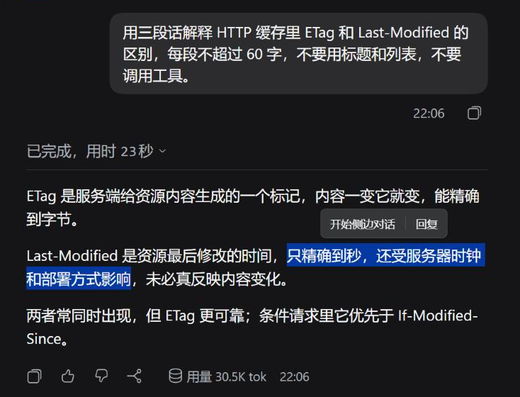
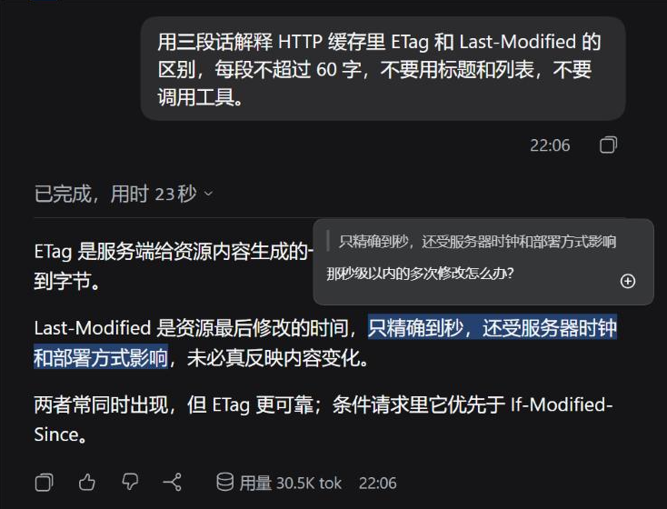
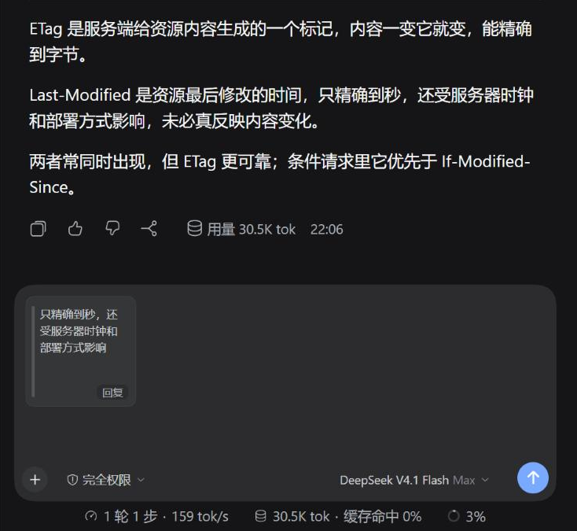
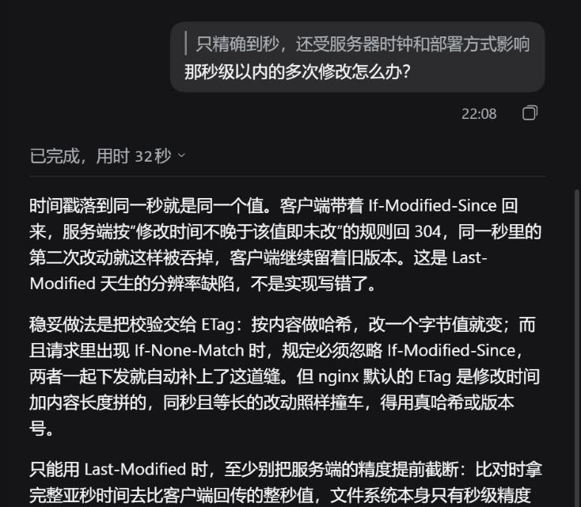
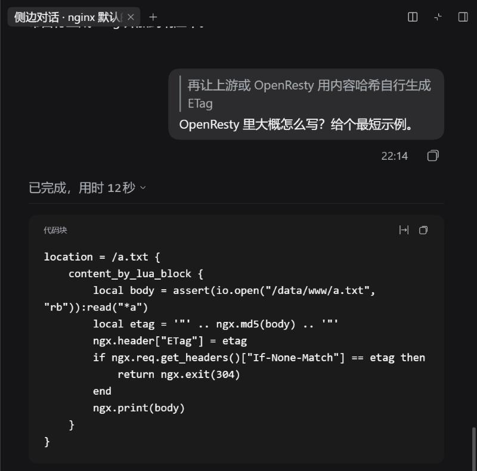

# dsh-claude-quote

中文 | [English](README.en.md)

给 DeepSeek Harness（DSH）的 Web / 桌面客户端加上 Claude Code Desktop 风格的选区引用：选中对话里的文字，就能针对这段话回复，或者拉一个侧边对话单独追问。

> 本项目与 Anthropic 无关，“Claude 风格”只是说明交互和样式参照的是 Claude Code Desktop。



## 功能

- **浮动工具条**：在对话里选中至少 2 个字符，选区上方出现「开始侧边对话 | 回复」。选区跨了多条消息时只给侧边对话；按 Enter 等同点「回复」，Esc 关闭。
- **回复弹窗**：320px 宽，顶部显示被引用的原文，原文在对话里保持高亮。
  - Enter：把「引用 + 评论」作为一张卡片放进输入框
  - Ctrl/⌘ + Enter：不经过输入框，直接发送
  - Esc 关闭；评论为空时点外面也会关闭
- **输入框引用卡片**：引用在输入框上方显示为 120×120 卡片，点击预览全文，右上角 × 移除。可以叠加多张，再写正文一起发。
- **已发送消息**：用户气泡里的引用渲染成左侧竖线的灰色引用块，评论跟在下面；超过 6 行折叠，点击展开。
- **侧边对话**：fork 当前会话（继承到这里为止的历史），在右侧栏打开，标题为「侧边对话 · 引用开头」，并把选区作为引用放进它的输入框。主对话不受影响。同一会话再次选中时，按钮变成「发送到侧边对话」；在侧边对话里只提供「回复」。
- 单段引用最长 1500 字，超出截断；界面支持中文和英文，跟随 DSH 的语言设置。






## 发送格式

和 Claude Code Desktop 一样，引用以纯文本 Markdown 发给模型，模型不需要任何额外支持：

```
<!-- reply -->
> 被引用的原文

你的评论
```

只引用、不写评论时用 `<!-- attach -->`。插件只识别出现在行首的这两种注释，正文里提到它们不会被误渲染。

## 安装

收录到 [awesome-dsh-plugin](https://github.com/awesome-dsh-plugin/awesome-dsh-plugin) 后，可在 dsh-market 插件市场里搜索 `dsh-claude-quote` 一键安装。

手动安装（本地开发）：把仓库克隆到本地，在 profile 的 `package.json` 里加上

```json
{
  "dependencies": {
    "dsh-client-ui-claude-quote": "link:/path/to/dsh-claude-quote"
  },
  "dsh": {
    "profile": {
      "bundles": ["dsh-client-ui-claude-quote"]
    }
  }
}
```

（`bundles` 是追加到已有列表，不是替换），在 profile 目录执行 `pnpm install`（或手动把仓库目录链接成 profile 的 `node_modules/dsh-client-ui-claude-quote`）后重启 DSH。Loader 行由包自带的 `cordis.patch.yml` 插入，不需要再改 profile 的 `cordis.patch.yml`。改 `lib/client.js` 后刷新页面即可生效。

## 兼容性

- 在 DSH 0.2.1-rc.2（DSH Desktop，Web 平台）上测试。
- 插件依赖对话区的 DOM 结构（`data-chat-node-key` 等属性）和 `uiConversation`、`sidebarRightTabs`、`sessions`、`resources` 等客户端服务，这些不是稳定的公开 API，DSH 升级后可能需要跟进。遇到问题请提 issue，并注明 DSH 版本。

## 开发

```
npm test
```

运行发送格式与解析规则的单元测试（不需要启动 DSH）。

## 许可

[MIT](LICENSE)
